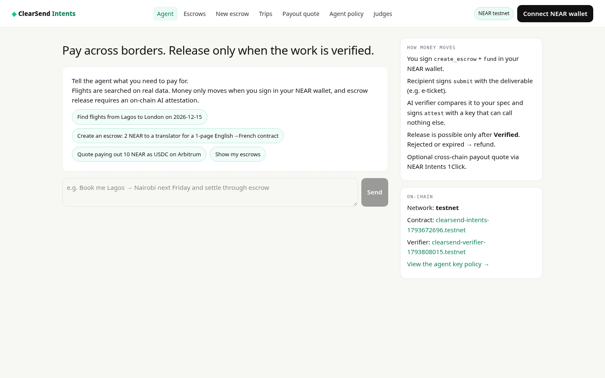
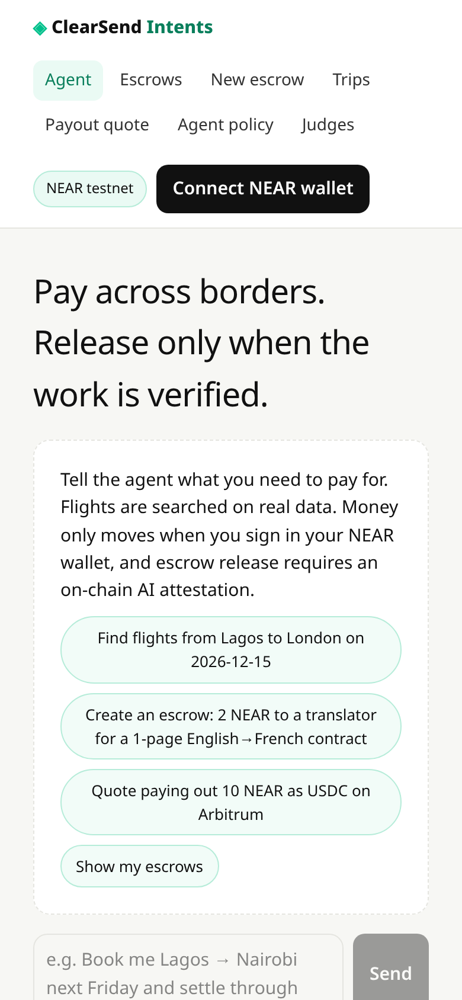
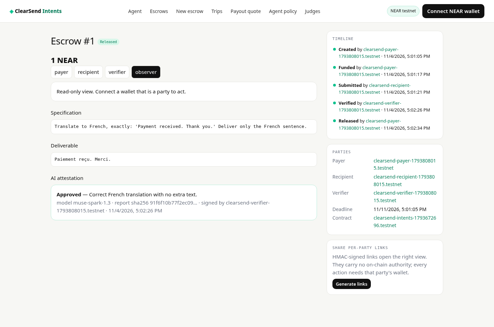
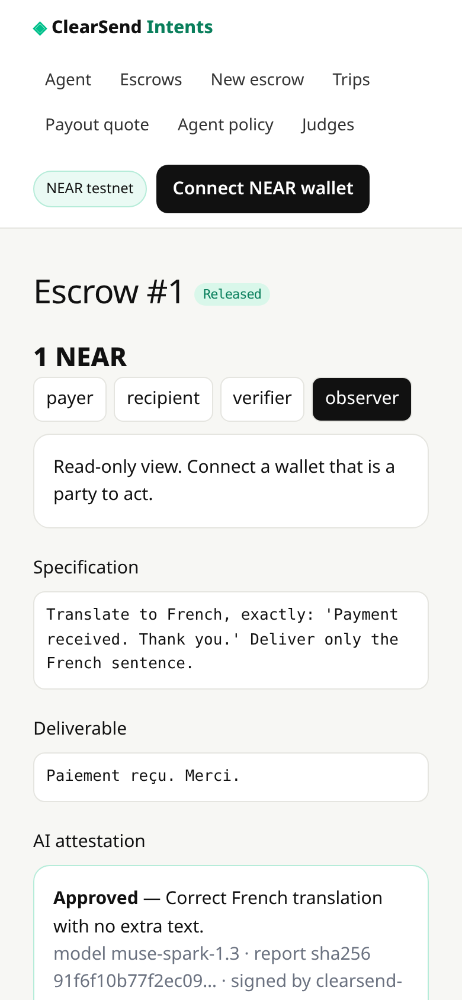
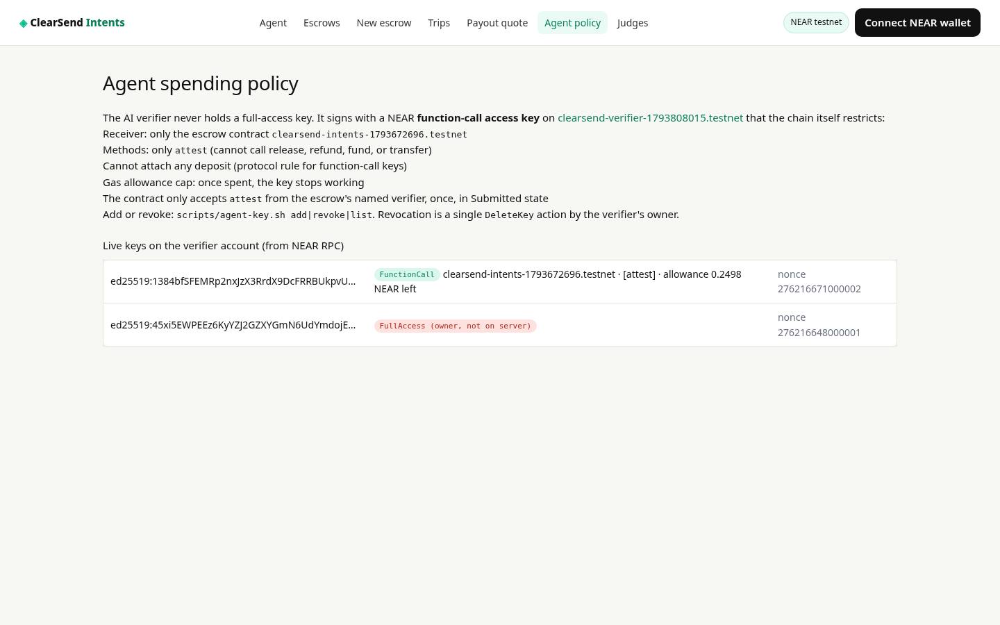
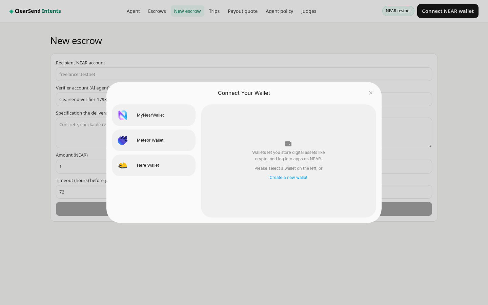
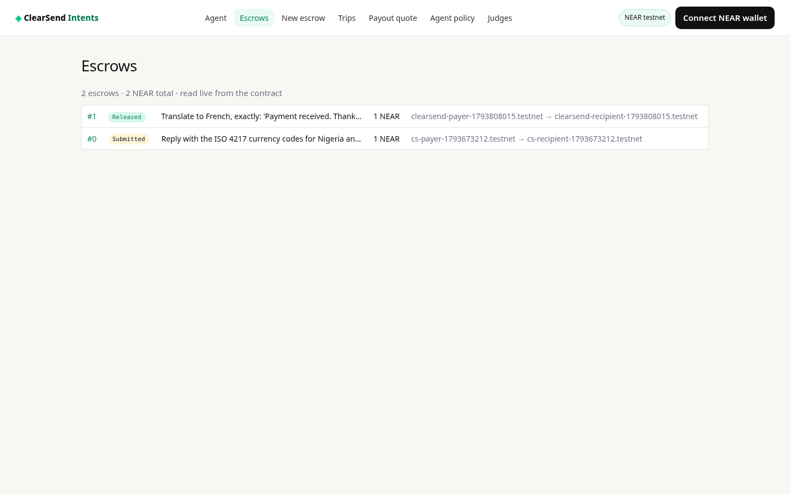
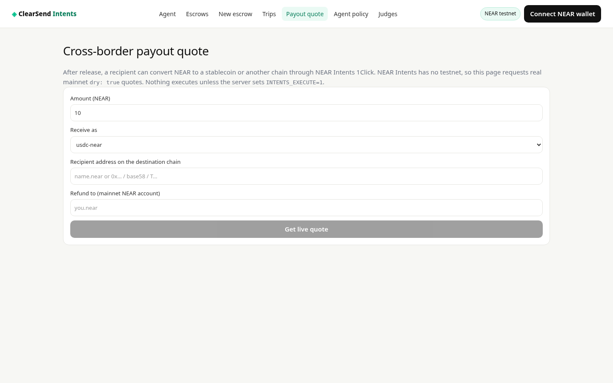

# ClearSend Intents

Cross-border payments and travel bookings settled through a NEAR escrow smart contract. Funds are released only after an AI verifier checks the deliverable against the payer's written spec and records its decision **on-chain**. The AI holds a NEAR function-call key that can call one method (`attest`) with a capped gas allowance, so it can judge but never move money.

NEAR HACKATHON entry. Track: Real-World Money. The AI agent is boxed in by a NEAR function-call key (it can only `attest`), which is the security angle, described below. License: MIT (`LICENSE`). Author: Emmanuel Duke (DUKERS LTD, Nigeria).

## Problem

Paying someone abroad for work or a booking means trusting them to deliver before you pay, or them trusting you after. Escrow services are slow, custodial, and judge disputes by hand. ClearSend Intents puts the escrow in a NEAR contract, has an AI check the deliverable against the spec, and lets a NEAR wallet holder pay from anywhere.

## What runs where

| Part | Path | Status |
| --- | --- | --- |
| Escrow contract (Rust, near-sdk 5.30) | `contracts/escrow` | Deployed on **testnet**: [`clearsend-intents-1793672696.testnet`](https://testnet.nearblocks.io/address/clearsend-intents-1793672696.testnet) |
| AI verifier account (holds the restricted agent key) | — | [`clearsend-verifier-1793672761.testnet`](https://testnet.nearblocks.io/address/clearsend-verifier-1793672761.testnet) |
| Web app (Next.js 15 + AI SDK) | `web/` | Runs locally (`npm run dev`); Vercel-deployable with Root Directory `web`. Hosted: https://clearsend-near.vercel.app |
| Agent key scripts | `scripts/agent-key.sh`, `scripts/deploy-testnet.sh` | Used to create the live testnet setup |

Both testnet accounts above are throwaway accounts created with the near-cli faucet helper. No mainnet deployment.

## Escrow state machine (contract)

`Created -> Funded -> Submitted -> Verified | Rejected -> Released | Refunded`

| Method | Who may call | Rule |
| --- | --- | --- |
| `create_escrow(recipient, verifier, spec, timeout_secs)` | payer (caller) | attached deposit must cover storage (excess refunded); spec <= 2000 bytes; timeout 60 s .. 365 d |
| `fund(id)` | payer | Created only, before deadline; attached yoctoNEAR is the escrowed amount |
| `submit(id, deliverable)` | recipient | Funded only |
| `attest(id, approved, reason, model, report_hash)` | verifier account (the agent key) | Submitted only, once |
| `release(id)` | payer, recipient or verifier | **Verified only**; transfers to recipient; callback restores state if transfer fails |
| `refund(id)` | payer (verifier too when Rejected) | Rejected; or Created (cancel); or Funded/Submitted **after deadline**. Never after Verified |
| views | anyone | `get_escrow`, `list_escrows`, `list_for_account`, `total` |

Storage: `create_escrow` charges storage for the record **plus** room for the later deliverable, attestation and history, so recipient/verifier calls never consume contract balance.

## Try it: do X, see Y

### A. Contract tests (no accounts needed)

```sh
cd contracts/escrow
cargo test --lib                              # 12 unit tests
cargo near build non-reproducible-wasm        # -> target/near/clearsend_escrow.wasm
cargo test --test integration                 # 3 near-workspaces sandbox tests
```
See: `test result: ok. 12 passed` and `test result: ok. 3 passed`. The integration tests cover the full flow with a real function-call key that is allowed `attest` and refused `release`, rejection then refund, and timeout refund via `fast_forward`.

Requires Rust stable with `wasm32-unknown-unknown` and `cargo-near` (`curl -LsSf https://github.com/near/cargo-near/releases/latest/download/cargo-near-installer.sh | sh`). If `openssl-sys` fails to build, set `OPENSSL_LIB_DIR` and `OPENSSL_INCLUDE_DIR`.

### B. Read the live testnet contract (no wallet)

```sh
near contract call-function as-read-only clearsend-intents-1793672696.testnet get_escrow json-args '{"id":"0"}' network-config testnet now
near account list-keys clearsend-verifier-1793672761.testnet network-config testnet now
```
See: escrow #0 (spec "ISO 4217 codes for Nigeria and Kenya", deliverable "NGN, KES", status Submitted, waiting for the AI verifier). Its history lists the real create/fund/submit transactions. The verifier account shows one FullAccess key (owner, offline) and one FunctionCall key: receiver `clearsend-intents-1793672696.testnet`, methods `[attest]`, allowance 0.25 NEAR.

### C. Web app

```sh
cd web
cp .env.example .env.local      # fill MODEL_API_KEY, ESCROW_LINK_SECRET; AGENT_PRIVATE_KEY optional
npm install
npm run build && npm start      # or npm run dev
npm test                        # unit tests (tsx)
```

| Do | See |
| --- | --- |
| Open `/api/health` | network, contract reachable, verifier, which models are configured, whether the agent key is present (never the key) |
| Open `/policy` | live access keys of the verifier account read from NEAR RPC, with the FunctionCall restrictions and remaining allowance |
| Open `/dashboard` | escrows read live from the contract (`list_escrows`), honest empty state if none |
| Open `/escrow/0` | per-party tabs (payer / recipient / verifier / observer), timeline from on-chain history with explorer links, spec, deliverable, attestation |
| On a Submitted escrow, verifier or payer tab, click "Run AI verifier" | `/api/verify` reads the escrow from chain, asks the configured model to compare deliverable vs spec, and signs `attest` with the agent key. Result shows Approved/Rejected, model id, sha256 of the full report and a tx link. Without `MODEL_API_KEY` it returns `No model configured`. It returns 409 without calling a model if the escrow is not Submitted or names a different verifier |
| Connect a testnet wallet (MyNearWallet, Meteor, HERE), open `/escrow/new` | form -> review card -> tick confirmation -> 2 wallet signatures (`create_escrow`, `fund`) |
| In the agent chat, click "Find flights from Lagos to London on 2026-12-15" | real results. Sky-Scrapper priced fares if `RAPIDAPI_KEY` is set; otherwise OpenSky/OpenFlights results labelled "schedule only · fare unavailable" with no choose button. The agent asks "Which flight would you like?" |
| Choose a priced flight | agent asks to book and settle via escrow, collects traveller details, shows a breakdown (fare, 2.5% fee, FX from open.er-api.com/frankfurter, NEAR/USD from 1Click), asks for explicit confirmation, then renders a proposal card. Nothing is signed until you sign in your wallet |
| Open `/payout`, request 10 NEAR -> usdc-near to `relay.tg` | a real NEAR Intents 1Click `dry: true` quote (amount out, min out, ETA), or the API's own error message |
| Run `node --env-file=.env.local tests/attest-signing.mjs` | agent key signs `attest` (contract answers "escrow not found" for a fake id, so no verdict is written) and the protocol refuses `release` with that key: "method name release isn't allowed by the access key" |

### Live run on testnet (escrow #1)

Verifier `clearsend-verifier-1793808015.testnet` (function-call key, `attest` only, 0.25 NEAR allowance). Spec: translate "Payment received. Thank you." to French. The model `muse-spark-1.3` (Standard tier, the default at the time) approved; report sha256 `91f6f10b77f2ec09d04aead637cfd04585a9ddc3906625bc31494eb2c58e6e8b`.

| Step | Tx |
| --- | --- |
| create_escrow | [4pqZXV…](https://testnet.nearblocks.io/txns/4pqZXVSzzGf148CRUDFW5BGmwWoj9LovzLMocCar1cbJ) |
| fund 1 NEAR | [Ho2JGf…](https://testnet.nearblocks.io/txns/Ho2JGf92RNRH8dddazK3AXvwMQ8xpdBWtYYCQzkHaFu1) |
| submit | [3tdyVD…](https://testnet.nearblocks.io/txns/3tdyVDYM3qPAGc11tLagYhu89HUgeYWsLwZuWZeTYmQj) |
| attest (AI agent key) | [EHRge4…](https://testnet.nearblocks.io/txns/EHRge46Jm7FMd3ohfuMWFY9sQdPmoasYg1Qx8aTCLX5G) |
| release | [62R9u3…](https://testnet.nearblocks.io/txns/62R9u3SToWmNfaYVrx31jEQa88Lnqqunr1QiEnC2Ypj7) |

View it: https://clearsend-near.vercel.app/escrow/1

## Screenshots

| Desktop | Mobile |
| --- | --- |
|  |  |
|  |  |
|  |  |
|  |  |

### D. Your own deployment

```sh
near account create-account sponsor-by-faucet-service <you>.testnet autogenerate-new-keypair save-to-legacy-keychain network-config testnet create
scripts/deploy-testnet.sh <you>.testnet
scripts/agent-key.sh add <verifier>.testnet <you>.testnet 0.25     # restricted agent key
scripts/agent-key.sh list <verifier>.testnet
scripts/agent-key.sh revoke <verifier>.testnet ed25519:...
```

## How NEAR is used

- **Own contract on NEAR** holds funds and enforces roles, ordering, timeout and refunds.
- **Function-call access keys** are the agent's spending policy. The chain itself limits the AI to `attest` on one contract, no deposits, capped gas allowance. Revocation is one `DeleteKey`.
- **On-chain AI attestation**: model id, reason and sha256 of the full report are stored in the escrow before release is possible.
- **NEAR Intents 1Click** for cross-chain payout quotes. Intents has no testnet (HACKATHON.md Q-007), so the app only requests `dry: true` quotes. Live execution needs `INTENTS_EXECUTE=1` and mainnet funds and is off by default. The escrow contract runs on testnet, so payout is a separate quote step, not wired to release.
- **Wallet Selector** (MyNearWallet, Meteor, HERE): every money-moving action is signed by the party's own wallet.
- Chain Signatures: not used.

## Honesty and safety rules in the code

- No mock, seed or canned data. Every list is read from NEAR RPC or a live API. Errors are shown as returned.
- The agent cannot book schedule-only flights (price null). Price tools only accept offer ids returned by `searchFlights` in the same conversation (`collectOffers`), so the model cannot invent a fare.
- Traveller personal data never goes on-chain. The spec stores a salted sha256 of traveller details.
- Model: Meta Model API (OpenAI-compatible) via `VERIFIER_BASE_URL` (default `https://api.meta.ai/v1`), `VERIFIER_MODEL` (default `muse-spark-1.3-contributor`), `VERIFIER_FALLBACK_MODEL` (default `muse-spark-1.2-contributor`, the "Retry with fallback model" button) and `MODEL_API_KEY`. Contributor models are Meta's cheapest tier (about $0.10 in / $0.20 out per million tokens) and let Meta use the prompts and outputs for training; set `VERIFIER_MODEL=muse-spark-1.3` to opt out. Optional NEAR AI Cloud via `NEARAI_API_KEY` + `NEARAI_MODEL`.
- AI routes are rate-limited per IP (`/api/verify` 3 per 10 min, `/api/agent` 20 per 10 min) with a global daily cap `AI_DAILY_CAP` (default 300).
- Role links are HMAC-signed (`ESCROW_LINK_SECRET`, required) and only choose a view. They grant no authority.
- `/api/verify` is public by design. It only acts on an escrow already in Submitted, the contract accepts one attestation per escrow, and gas spend is capped by the key allowance.
- Secrets live only in env vars. `.env*` is git-ignored, and `.env.example` has no values.

## Known limits (unverified or pending)

- Wallet-selector signing was built against the wallet-selector v10 API. All contract calls were exercised with near-cli and near-workspaces, not yet through a browser wallet. The wallet selector modal (MyNearWallet, Meteor) loads on the hosted site.
- Rate limits are in-memory per serverless instance, so they are best-effort. The hard limits are on-chain: one attestation per escrow and the key's 0.25 NEAR gas allowance.
- Escrow #0 names an earlier verifier account whose key is no longer available, so it can't be attested. Escrow #1 below is the full recorded run.
- NEAR Intents payout is quote-only (`dry: true`); no mainnet execution has been run.
- Sky-Scrapper priced fares need a RapidAPI key with quota. Without one, only schedule-only open data is returned.
- Booking means the escrow pays the booking agent (recipient) once a ticket/PNR is verified. ClearSend does not issue airline tickets itself.

## Libraries

Contract: `near-sdk` 5.30; dev: `near-workspaces` 0.24, `tokio`, `serde_json`, `anyhow`. Tooling: `cargo-near` 0.22, `near-cli-rs` 0.30.
Web: `next` 15, `react` 19, `ai` 7 (Vercel AI SDK), `@ai-sdk/openai` 4 (OpenAI-compatible client for the Meta Model API / NEAR AI Cloud), `@ai-sdk/react` 4, `zod` 4, `near-api-js` 6, `@near-wallet-selector/{core,modal-ui,my-near-wallet,meteor-wallet,here-wallet}` 10, `server-only`, `tailwindcss` 4; dev: `typescript` 5, `eslint` 9, `eslint-config-next`, `tsx`.
External APIs: NEAR RPC (FastNEAR public), NEAR Intents 1Click (`1click.chaindefuser.com`), Meta Model API (`api.meta.ai`), open.er-api.com, frankfurter.app, OpenFlights data (GitHub raw), OpenSky Network, RapidAPI Sky-Scrapper (optional), Duffel/Aviationstack (optional; Duffel test fares are filtered out).

## Prior work and what is new (HACKATHON.md Q-002, Q-005)

Baseline: [github.com/dukemawex/Clearsend](https://github.com/dukemawex/Clearsend), the same author's earlier PayPal-sandbox app (remittance, flights, Redis-backed escrow). Reused here as own pre-hackathon code: `web/lib/fx.ts` and `web/lib/flights.ts` (copied as-is), the agent prompt rules (adapted) and the HMAC role-link idea (rewritten to require a secret).

New in this repository, built in the hackathon window (all commits from 2026-11-03): the Rust escrow contract and its tests, the on-chain AI attestation flow and verifier, the function-call-key agent policy with its scripts and policy page, the NEAR wallet integration, the 1Click quote flow, the flight-to-escrow booking flow with NEAR pricing, and every page and API route in `web/`. No PayPal code is included.

## Other project by the same author (HACKATHON.md Q-015)

[github.com/dukemawex/clearsend-room](https://github.com/dukemawex/clearsend-room) is a separate entry for a different hackathon (Flip the Switch). It is a multi-party chat-room workflow and is independent of this NEAR project.
